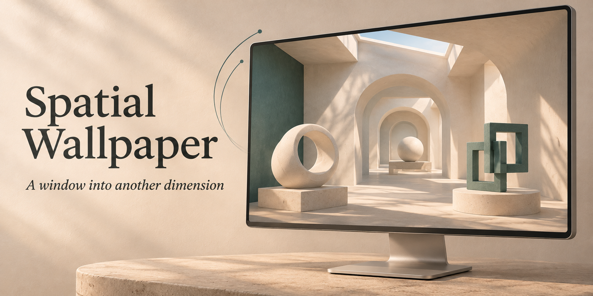
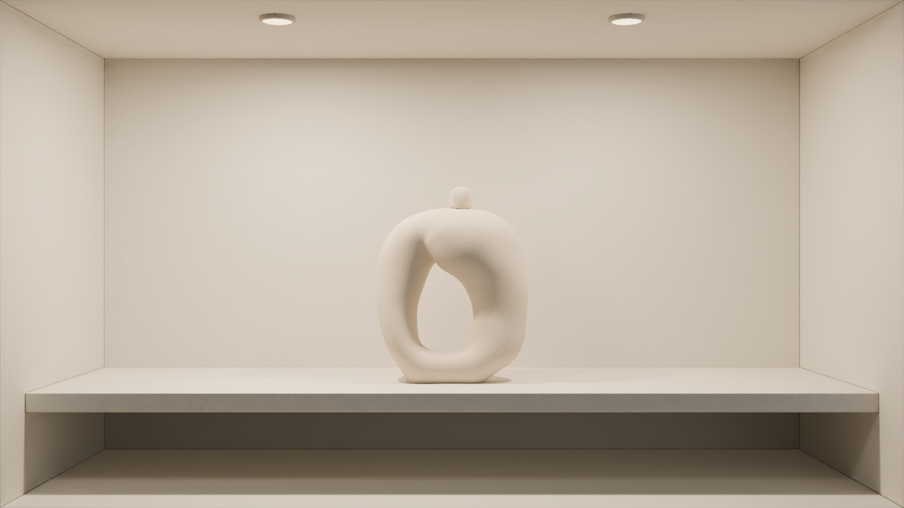
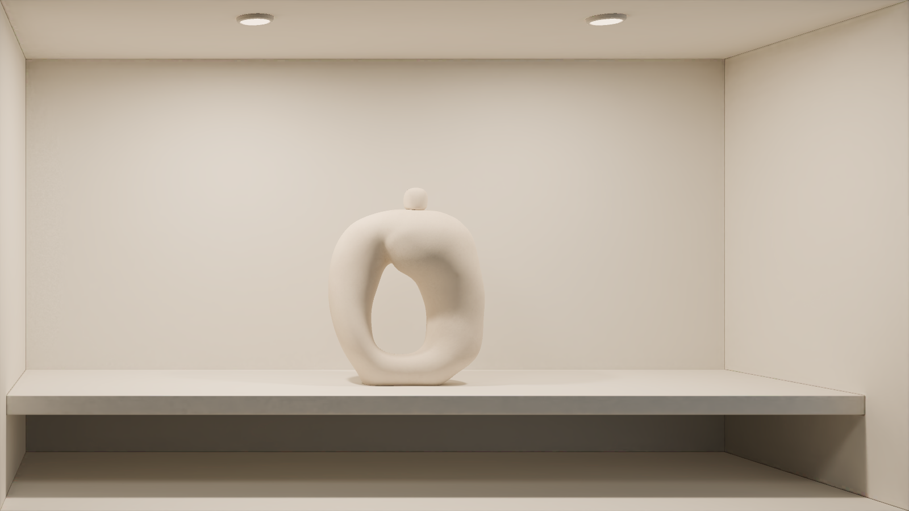
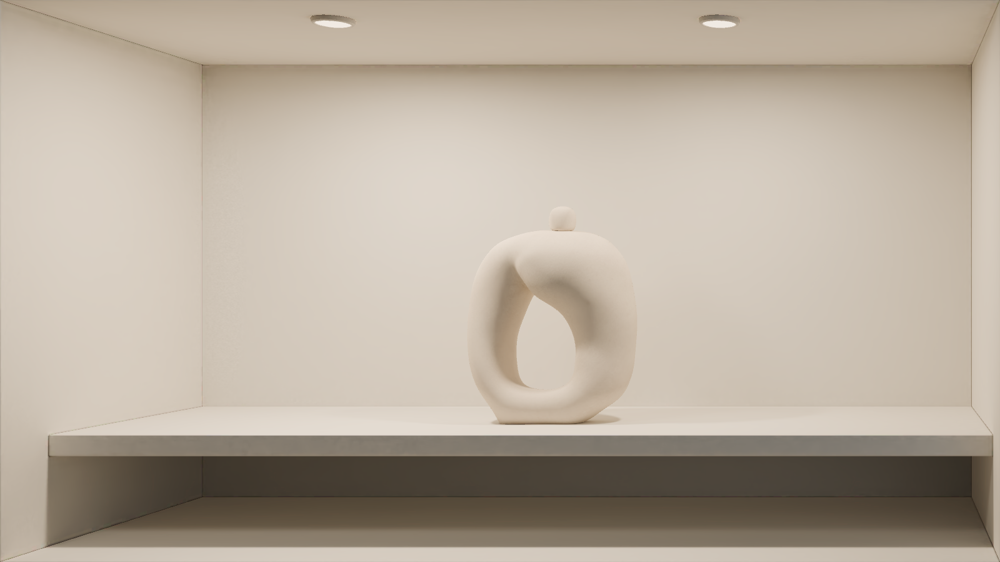

# Spatial Wallpaper

**Turn an ordinary display into a window you can look around.**

Head-tracked perspective brings depth to your desktop: a display cabinet, a quiet room, or a small interactive world.

[简体中文](README.md) · [Create a wallpaper](Packages/com.spatialwallpaper.sdk/Documentation~/GettingStarted.md) · [Contribute](docs/public/CONTRIBUTING.md)

Windows x64 · Native Unity rendering · SDK 0.4.0-preview.1 · MIT

## See the depth

| View from the left | View from the right |
| :---: | :---: |
|  |  |

The cover is promotional concept art. Scene images come from existing Unity rendering records, not a new camera or multi-display acceptance test. [Image sources](docs/public/assets/README.md).

## What you can do

- Display native Unity scenes with head-tracked off-axis projection.
- Create interactions using isolated author scripts, controlled scene commands and asynchronous storage.
- Import, preview, apply and update wallpapers through one Library. Installing an update keeps the applied revision playing until you explicitly apply it.
- Share reviewed revisions through GitHub Releases and metadata pull requests, with a signed discovery index and Issues for feedback.

The complete local distribution includes Showcase, Parking, Train, RainyCafe and MiniShot. Existing original works and blueprint compatibility remain available.

## Get started

This is a **development preview**. Public Releases contain the standalone validator and original CC0 example. The complete desktop distribution containing original artwork assets is **not available for public download** until their redistribution rights are verified.

If you have the complete Windows package:

1. Extract the entire portable ZIP into a new directory and run **Launch.exe**. Keep all neighboring files. Windows x64 and .NET Framework 4.8 are required; Unity and Python installations are not.
2. Choose a wallpaper in **Library** and open its preview. Configure your camera and calibration if you use tracking.
3. Select a display and explicitly apply the wallpaper. Closing the manager keeps it playing; reopen from the tray. Fully exit to stop playback and restore the system wallpaper.

[Installation, sound and recovery](docs/guides/SDK0.4发行与体验.md) · [Public Releases](https://github.com/KyaKayKya/Spatial-Wallpaper-Community/releases)

NativeValidator is a package checker, not a player. The CC0 example requires a matching complete client to play. The public source snapshot omits private history and separately licensed artwork assets; see [Development](docs/public/DEVELOPMENT.md).

## Build a wallpaper

Use Unity 2022.3.62f3 and URP 14.0.12 with the matching SDK. Follow the [SDK guide](Packages/com.spatialwallpaper.sdk/Documentation~/GettingStarted.md), export through ExternalNativeExporter, validate the actual package, and document redistribution rights for every resource. Publish immutable binary assets in your GitHub Release, then submit one exact revision and package SHA256 for review.

[Author export guide](docs/guides/外来原生作品导出.md) · [Submission guide](docs/guides/壁纸市场创作者入门.md) · [Example revision PR](https://github.com/KyaKayKya/Spatial-Wallpaper-Community/pull/11)

External author packages support a strict static-data and Shader subset. Skinning, Animator, probes and some resource references remain unsupported and are rejected explicitly. Built-in original works use a separate trusted asset path. Script isolation does not certify resource ownership, visual quality or all GPU risks.

## Discover and contribute

The client verifies the [signed market index](https://github.com/KyaKayKya/Spatial-Wallpaper-Community/releases/download/market-index/published.json) and package bytes. Cached listings can be browsed offline. A changed author manifest does not approve a new revision automatically.

Feedback uses a stable work-associated GitHub Issue: anonymous reading, GitHub sign-in to participate, no high-privilege PAT. [Discuss the CC0 example](https://github.com/KyaKayKya/Spatial-Wallpaper-Community/issues/3).

Popularity measures a rolling seven-day increase in Release asset downloads, not installations or ratings. Missing data stays unknown; the metric cannot eliminate manipulation. Report a work with its GUID, revision and package hash. Withdrawal does not silently delete installed content or switch the playing revision.

## License and status

Project-authored code is [MIT](LICENSE). Third-party code and artwork keep their own terms: [License scope](PROJECT_LICENSE_SCOPE.md), [Third-party notices](THIRD_PARTY_NOTICES.md). Open source does not grant redistribution rights for original models, textures or music.

[SOURCE_MANIFEST.json](SOURCE_MANIFEST.json) and [SHA256SUMS](SHA256SUMS) identify the frozen source. Visual quality, audible layered sound, real MiniShot input, physical multi-display behavior and long-term experience still require manual acceptance. See the [release guide](docs/guides/SDK0.4发行与体验.md).
