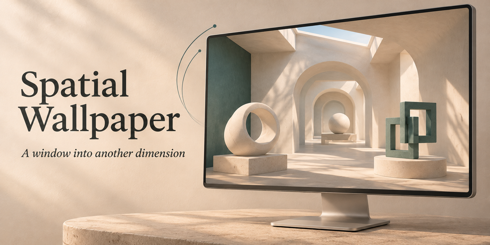
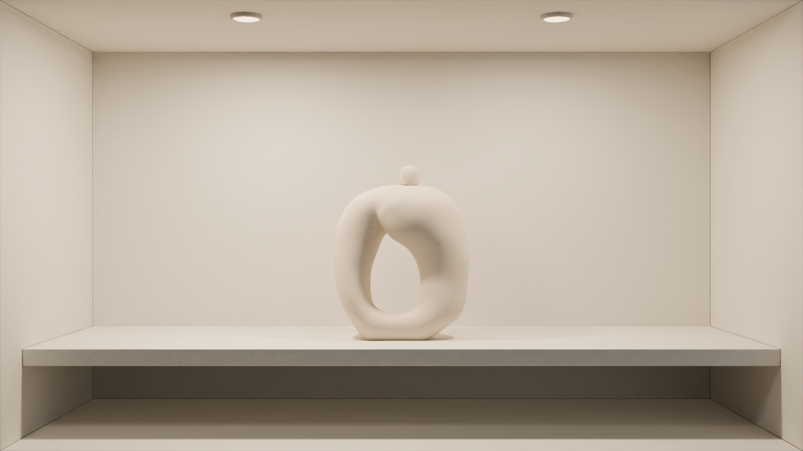
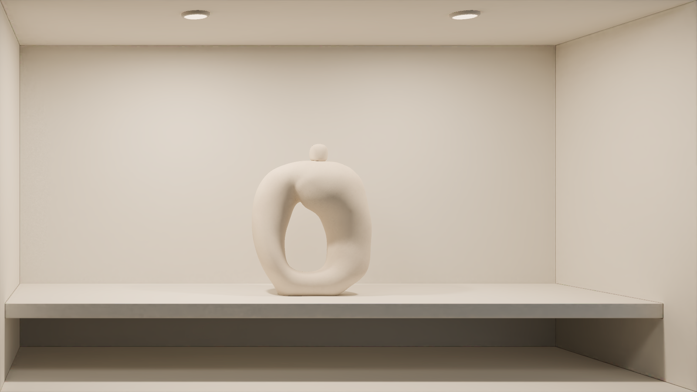
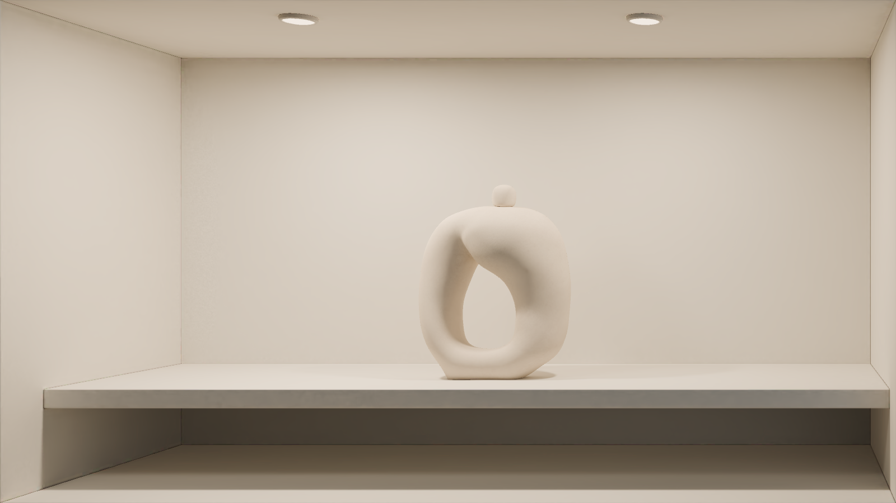

# Spatial Wallpaper · 空间壁纸

**让普通屏幕，成为一扇可以探头观看的三维窗口。**

用摄像头感知观察位置，让桌面里的空间随你的视点展开。
把副屏变成展示柜、雨夜角落，或一件可以互动的小作品。

[开始使用](#开始使用) · [制作作品](#制作你的第一件作品) · [参与共创](docs/public/CONTRIBUTING.md) · [English](README.en.md)

Windows x64 · Unity 原生渲染 · SDK 0.4.0-preview.1 · MIT

## 看看它如何呈现空间

同一场景，观察位置改变，物体之间的遮挡与可见侧面也随之改变：

| 从左侧看 | 从右侧看 |
| :---: | :---: |
|  |  |

*封面是宣传概念图；这里的展示柜图片来自项目已有的真实 Unity 渲染记录，展示空间投影效果，不是本次发行新做的摄像头或多屏验收。[图片来源](docs/public/assets/README.md)*

## 不止是一张会动的背景

- **桌面上的三维空间。** 原生 Unity 场景直接渲染；观察位置驱动离轴投影，保留模型、材质、灯光与声音。
- **让作品可以互动。** 作者脚本在隔离进程中运行，使用受控场景命令、真实视图快照和异步存档。
- **一套作品库管理。** 浏览、预览、导入和显式应用都在原 Library 中；安装更新后，正在播放的旧修订继续保留，直到你选择应用。
- **一起创作和分享。** 用 GitHub Release 保存作品包，通过 PR 审核具体修订与摘要，再进入客户端的签名市场索引。

完整本机发行包含白色展示柜 **Showcase**、阈限空间 **Parking**、复古车厢 **Train**、雨夜咖啡馆 **RainyCafe** 和先行者 **MiniShot** 五件原生作品；旧作品、Pool、Limpool、Mita 和蓝图兼容链路保留。

## 开始使用

这是开发预览，接口和外来资源支持仍在完善。公开仓库提供源码、验证器与原创 CC0 示例；**含原作品素材的完整桌面安装包尚未公开下载**，因为这些素材的再分发许可仍需逐项核实。

### 已取得完整 Windows 发行包

1. 将便携 ZIP **完整解压到新的目录**，运行 `Launch.exe`。保留同目录的数据、Python、Tracker 与运行库；无需另装 Unity 或 Python，系统需要 Windows x64 和 .NET Framework 4.8。
2. 在 **Library** 中选作品，先打开 **预览**；使用摄像头时完成设备选择与校准。
3. 选择目标显示器，再点击 **应用到桌面**。关闭管理器后继续播放，从原托盘重开；完全退出用于停止播放并恢复系统壁纸。

[安装、声音、更新与恢复指南](docs/guides/SDK0.4发行与体验.md)

### 从公开内容开始

在 [Releases](https://github.com/KyaKayKya/Spatial-Wallpaper-Community/releases) 下载匹配的 **NativeValidator-Windows.zip** 与 **Original CC0 Triangle 1.0.2**。验证器用于检查作品包，**不是完整播放器**；示例包需要导入匹配的完整客户端才能播放。

源码也可以直接阅读和修改：[开发环境与目录](docs/public/DEVELOPMENT.md)。本仓库没有私有开发历史，原作品的大型资产不会随源码快照附带。

## 制作你的第一件作品

创作使用 Unity **2022.3.62f3** 与 URP **14.0.12**，播放不需要 Editor。

1. 安装 `Packages/com.spatialwallpaper.sdk` 或匹配发行中的 SDK tarball，按 [SDK 入门](Packages/com.spatialwallpaper.sdk/Documentation~/GettingStarted.md) 设置独立作者工程。
2. 为原创场景设置稳定 GUID，通过 `ExternalNativeExporter` 导出，再用可信 `NativeValidator` 检查实际文件。
3. 逐项核实模型、贴图、Shader、脚本和声音的分发权，生成可投稿包，将不可变产物上传到自己的 GitHub Release。

[外来原生作品导出](docs/guides/外来原生作品导出.md) · [投稿指南](docs/guides/壁纸市场创作者入门.md) · [SDK 源码](Packages/com.spatialwallpaper.sdk)

原生渲染与作者脚本隔离分别处理资源、进程和 GPU 风险，不等于任意插件都能安全运行。外来作者包目前接受严格的静态数据与 Shader 子集；骨骼、Animator、探针及部分资源引用不支持时会明确拒绝。完整内置作品使用独立的可信原资产路径。

## 发现作品，一起共创

[市场签名索引](https://github.com/KyaKayKya/Spatial-Wallpaper-Community/releases/download/market-index/published.json)由审核后的工作流生成，客户端验证索引签名及下载内容。已获取索引支持离线浏览；网络失败和限流会显示错误。

投稿需要把**稳定 GUID、确切修订和实际包 SHA256** 作为一个 PR 送审。仅修改作者仓库清单不会自动批准新修订。[一次真实的修订投稿](https://github.com/KyaKayKya/Spatial-Wallpaper-Community/pull/11)可供参考。

- **交流与反馈：** 从作品详情打开关联 GitHub Issue；匿名可浏览，参与时登录 GitHub，无需填写高权限 PAT。[原创示例讨论](https://github.com/KyaKayKya/Spatial-Wallpaper-Community/issues/3)
- **热度排行：** 使用最近七日 Release 资产下载增量，不是安装人数或评分；缺数据时显示未知，也不能彻底防刷。
- **举报与撤回：** 附作品 GUID、修订和包摘要提交 [Issue](https://github.com/KyaKayKya/Spatial-Wallpaper-Community/issues/new)。下架不静默删除本地作品或改变正在播放的确切修订。

[投稿与审核规则](docs/guides/壁纸市场维护.md) · [贡献指南](docs/public/CONTRIBUTING.md)

## 开放源码，保留素材边界

项目自有代码采用 [MIT](LICENSE)，欢迎学习、修改与贡献。第三方代码及作品素材保留各自许可；源码开放不授予原模型、音乐或贴图的再分发权。详见 [许可范围](PROJECT_LICENSE_SCOPE.md)与[第三方说明](THIRD_PARTY_NOTICES.md)。

源码快照的冻结来源与文件摘要见 [SOURCE_MANIFEST.json](SOURCE_MANIFEST.json) 和 [SHA256SUMS](SHA256SUMS)。项目仍为预览版本：真实画质、声音、MiniShot 输入、物理多屏及长期体验的验收范围见[发行指南](docs/guides/SDK0.4发行与体验.md)。
